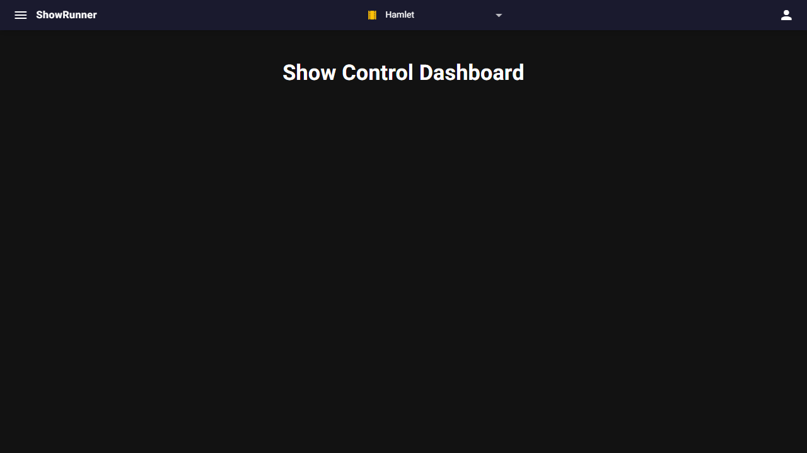
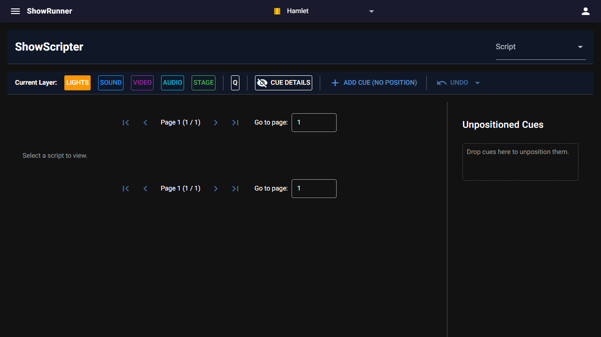

# 03 — In the browser

> **Runtime-bound: a server and a browser.** This page starts `sr start` on a
> free port with its own database and drives it in Chromium. If either is
> missing it fails rather than skips.

The pictures on this page come from the same run as the assertions beside them.
They are recorded and never compared: `uv run pytest` writes them again, and a
change to the UI shows up as a modified file in `git status`.

```python
>>> from playwright.sync_api import expect
>>> from walkthrough.support import LiveApp, Shots, chromium, release
>>> app = LiveApp().start()
>>> app.post('/db/shows?name=Hamlet')['name']
'Hamlet'
>>> shots = Shots('03-in-the-browser')
>>> browser = chromium()
>>> page = browser.new_page(viewport={'width': 1280, 'height': 720})

```

`sr check --url <address> --shots <directory>` runs this page against a server
that is already up, as the performing family's demo does: `LiveApp` then
attaches to that server rather than starting one, and the pictures are written
to the directory it names rather than beside this page.

## The dashboard

The header carries the menu, the show selector and plugin status. With one show
in the database, it is selected:

```python
>>> _ = page.goto(app.base)
>>> expect(page.get_by_text('Show Control Dashboard')).to_be_visible()
>>> expect(page.locator('header').get_by_text('Hamlet')).to_be_visible()
>>> shots.take(page, 'dashboard')
'03-in-the-browser-dashboard.png'

```



## The script view

The menu lists each plugin's page. Scripts opens `/script`, with one button per
cue layer. No script is selected yet, and no cues exist to position:

```python
>>> page.locator('header button').first.click()
>>> page.get_by_text('Scripts', exact=True).click()
>>> page.wait_for_url(app.base + '/script')
>>> for layer in ('Lights', 'Sound', 'Video', 'Audio', 'Stage'):
...     expect(page.get_by_role('button', name=layer)).to_be_visible()
>>> expect(page.get_by_text('Select a script to view.')).to_be_visible()
>>> expect(page.get_by_text('Unpositioned Cues')).to_be_visible()
>>> page.mouse.move(0, 0)
>>> shots.take(page, 'script')
'03-in-the-browser-script.png'

```



```python
>>> release(browser)
>>> app.stop()

```
